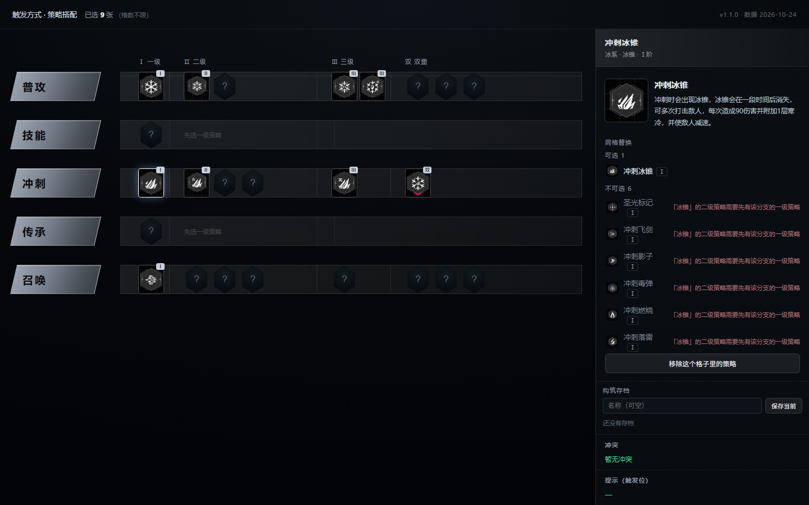

# 苍翼混沌效应 · 策略搭配器（网页版）

**非官方、非商业粉丝工具**：在不开游戏的前提下，按游戏真实规则自由拼策略，实时告诉你「这样搭合不合法、违反了哪条」。
界面里 297 张卡全部带实机图标，可直接看到游戏内描述、触发位与解锁条件原文；双重策略触发位不符会**阻断并给提示**。

- 纯静态网页，不需要安装、不需要后端；首次打开后支持离线（PWA）。
- 只做桌面宽屏（≥1280px）；不做手机版、不做分享/导出。
- 不计算伤害、不做路线推荐、不修改游戏文件。



## 怎么用

### 在线版（推荐）

仓库部署到 GitHub Pages 后，从仓库 **Settings → Pages** 取得访问地址。
用 Edge / Chrome 打开后，地址栏右侧「安装」可把它装成独立窗口（无地址栏，可固定到任务栏）。

### 本地版

下载完整目录（不能只拿 `index.html`），双击 `index.html` 即可；`js/`、`icons/`、`assets/` 必须和它在一起。

开发时也可以用本地静态服务器（PWA / Service Worker 需要 http）：

```bash
npm run serve
```

然后打开命令输出的地址。

## 功能

| 功能 | 说明 |
|---|---|
| 297 张策略卡 | 一级 51 / 二级 109 / 三级 37 / 双重 100；图标、游戏内描述、解锁条件 |
| 实时校验 | 分支互斥、进阶链、双重前置分组、效果分支三级、触发位、行归属、重复卡 |
| 候选解释 | 每个不可选的卡都写明原因；已选卡自动从候选里过滤 |
| 双重策略 | 触发位不符时同时给「冲突」和「提示」；按卡面锚点归位，效果分支仍按原图鉴算三级 |
| 构筑存档 | 保存当前、逐条导入/删除，存在浏览器 `localStorage` |
| 离线 | 首次访问后由 Service Worker 缓存；断网可继续用 |

## 规则

| 规则 | 含义 |
|---|---|
| 第 1 格决定分支 | 一级策略只能放在该行第 1 格 |
| 一行一条分支 | 第 2 格起只能放该分支的进阶与双重策略 |
| 同分支一级唯一 | 「普攻寒冷 / 技能寒冷」互斥 |
| 二级/三级/双重可多张 | 二级最多 5 格、三级 2 格、双重 5 格（槽位 2~6 / 7~8 / 9~13） |
| 进阶链 | 二级需要本分支一级；三级需要本分支二级 |
| 双重前置 | 前置是分组：组内任一、组间都要 |
| 双重效果分支 | 还需要「效果分支」的三级在场（不是占位分支） |
| 触发位 | 双重只能放在卡面标注的触发位，否则阻断 + 提示 |
| 卡牌不重复 | 同一张卡不能放两个格子 |

规则参数与数据都在 `data/`，构建时会被内联进 `js/data.js`。

## 不做什么

- 不算伤害、不推荐路线、不改游戏文件。
- 不做手机版：按桌面宽屏设计；窄屏只会给一条提示。
- 不做分享链接 / 导出文件：构筑存档只在当前浏览器，清缓存会丢。

## 数据与版本

- 数据版本：`2026-10-24`；应用版本见 `package.json` 与页面右上角。
- 297 张卡都有 256px WebP 图标（由游戏内实机截图裁切压缩，不是原生素材）。
- 数据整理参考游戏内文本与社区图鉴；卡名与规则以游戏内为准。
- 297 张而不是 299：删掉了不存在的卡与文字表误读的重复项。

## 开发

需要 Node.js ≥ 20；运行时不依赖 Node，只有构建/测试需要。

```bash
npm run build        # data/*.json -> js/data.js + build-report.json
npm run build:check  # 只检查产物是否与数据一致（CI 用）
npm test             # 50 组测试：规则 36 + 实机构筑 4 + 素材 6 + 参考实现对拍 4
npm run verify       # 发布前严格校验（构建一致性、图标、本机信息、体积、引用、测试）
```

目录：

```
index.html  style.css  manifest.webmanifest  sw.js
js/         data.js（生成） rules.js app.js
data/       strategies.json media.json meta.json（构建输入）
icons/      297 张 WebP
assets/     PWA / favicon 图标
tests/      规则、实机构筑、素材、Python 参考实现对拍
tools/      build.mjs verify.mjs serve.mjs make_icons.py make_app_icons.py
```

### 维护数据

1. 改 `data/strategies.json` 或 `data/media.json`；
2. `node tools/build.mjs --write-meta` 更新规范哈希并重新生成 `js/data.js`；
3. 用 Python 参考实现重新生成 `tests/fixtures/parity.json`（说明见 `tests/fixtures/README.md`），否则对拍测试会失败；
4. `npm run verify`，全绿再提交。

`tests/fixtures/parity.json` 是从参考实现生成的黄金向量（915 组校验 + 150 组候选），用来保证 JS 移植与参考实现逐条一致。改动规则时必须重新生成，不能手改。

图标重建（可选，需要 Python 3.10+ 与 Pillow）：

```bash
python tools/make_icons.py --src <原始 PNG 目录> --out icons --size 256 --quality 82
```

## 部署到 GitHub Pages

1. 仓库推送到 GitHub，默认分支 `main`；
2. **Settings → Pages → Build and deployment → Source** 选 **GitHub Actions**；
3. `.github/workflows/pages.yml` 会在每次推送 `main` 时校验并部署。

CI（`.github/workflows/ci.yml`）在每次 push / PR 运行 `npm run verify`。

## 已知限制

1. **图标是截图裁切**，不是游戏原生素材；256px 下识别够用，深度放大有损。
2. **规则来自卡面文本与两套实机构筑**，没有逐条对游戏源码验证；个别触发位可能仍有差异，以游戏内为准。
3. **只做桌面宽屏**：窗口 < 1200px 只显示提示，不重排。
4. **存档只在本地浏览器**：换浏览器、清缓存会丢；不支持分享。
5. PWA 安装只在 Chromium 系浏览器（Edge / Chrome）提供；Firefox 只能当普通网页。

## 许可与声明

- 代码：[MIT](LICENSE)。
- 游戏名称、卡牌名称、卡牌描述、图标等素材版权归其权利人所有；本项目与开发商/发行商无隶属关系。
- 本项目不包含游戏本体文件，也不修改游戏。
- 图标仅用于识别卡牌。如权利人要求，删除 `icons/` 后界面会自动回退为元素字占位，无需改代码。
- 详见 [NOTICE](NOTICE)。
